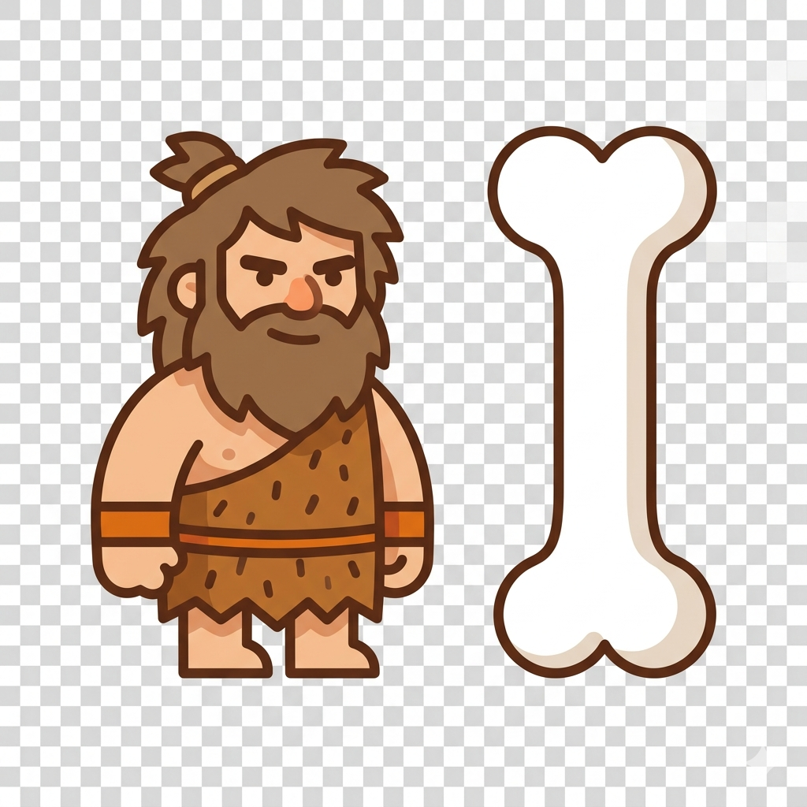

<p align="center">
  
</p>

<h1 align="center">🦴 Caveman</h1>

<p align="center"><b>Fewer tokens. Safer prompts. Provable compliance.</b><br/>
The .NET toolkit that compresses, protects and governs what you send to an LLM - 50+ languages, no model to download, no API call.</p>

<p align="center">
  <a href="https://www.nuget.org/packages/Caveman"></a>
  <a href="https://www.nuget.org/packages/Caveman.Mcp"></a>
  <a href="https://www.nuget.org/packages/Caveman.SemanticKernel"></a>
  <a href="https://www.nuget.org/packages/Caveman.PrivacyGuard"></a>
  <a href="https://www.nuget.org/packages/Caveman.Compliance"></a>
  <a href="https://www.nuget.org/packages/CavemanML"></a>
  
  
</p>


> "Why use many tokens when few tokens do trick?" - A caveman (and your wallet).

Caveman started as a prompt compressor and grew into a small family of packages that cover the whole life of a prompt: **shrink it** (Caveman), **clean it** (PrivacyGuard), **govern it** (Compliance) and **plug it into your tools** (MCP, Semantic Kernel, Copilot). Every package is independent - take only what you need.

It is an independent implementation written from scratch (inspired by the token-saving idea behind the Caveman plugin for Claude): **pure lookup + heuristics, zero runtime ML dependency** - and an optional ML tier, [`CavemanML`](#-the-caveman-family), for when you want learned compression and learned PII detection.

## 📦 The Caveman family

Every NuGet package published by the Caveman projects, with its icon, what it is for, and how to get it.

| | Package | Version | What it is | Install |
|:-:|:--|:-:|:--|:--|
|  | **[Caveman](https://www.nuget.org/packages/Caveman)** <br/>*core library* · `net8.0` | `1.4.6` | The prompt compressor: 5 compression levels over 50+ languages, content router (JSON, logs, diffs, HTML, SQL, code, tables), retrieval, summarizers, agent memory, cost and energy estimators. Language data embedded, nothing to download. | `dotnet add package Caveman` |
|  | **[Caveman.Mcp](https://www.nuget.org/packages/Caveman.Mcp)** <br/>*MCP server* · `net8.0` | `1.4.5` | Model Context Protocol server exposing Caveman to **Claude Code, OpenCode, Cursor, Windsurf** and any MCP client: `compress`, `compress_batch`, `compress_sql`, `detect_language`, `route_content`, `summarize`, `retrieve`, `skeletonize_code`, `near_duplicate`, `idf_languages`. | `dotnet tool install -g Caveman.Mcp` |
|  | **[Caveman.SemanticKernel](https://www.nuget.org/packages/Caveman.SemanticKernel)** <br/>*plugins* · `net8.0` | `1.4.5` | Eight Semantic Kernel plugins - `TokenOptimizer`, `CavemanRouter`, `CavemanRetrieval`, `CavemanSummarization`, `CavemanConversation`, `CavemanOutput`, `CavemanServices`, `CavemanWiki` - so the *model* can manage its own context window. | `dotnet add package Caveman.SemanticKernel` |
|  | **[Caveman.PrivacyGuard](https://www.nuget.org/packages/Caveman.PrivacyGuard)** <br/>*PII engine* · `net8.0` `netstandard2.0` | `1.3.1` | Enterprise PII & privacy analyzer: **32 countries**, checksum- and context-confirmed detection, reversible masking sessions, streaming and document masking, prompt-injection guard, AI-transparency notice, GDPR / AI Act / NIS2 / PCI-DSS flags. | `dotnet add package Caveman.PrivacyGuard` |
|  | **[Caveman.PrivacyGuard.Mcp](https://www.nuget.org/packages/Caveman.PrivacyGuard.Mcp)** <br/>*MCP server* · `net8.0` | `1.3.1` | PrivacyGuard as MCP tools: `analyze_text`, `mask_text`, `restore_text`, `mask_stream`, `mask_document`, `session_summary`, `check_prompt_injection`, `get_ai_transparency_notice`. | `dotnet tool install -g Caveman.PrivacyGuard.Mcp` |
|  | **[Caveman.Compliance](https://www.nuget.org/packages/Caveman.Compliance)** <br/>*governance* · `net9.0` | `1.0.0` | The AI compliance gate: 19 controls with risk / action / scope, EU AI Act · GDPR · NIS 2 · ISO 42001 **traceability matrix**, hash-chained **audit trail** (Art. 12), and **technical file, DPIA, FRIA and executive report** as JSON and **PDF**. | `dotnet add package Caveman.Compliance` |
|  | **[CavemanML](https://www.nuget.org/packages/CavemanML)** <br/>*learned models* · `net8.0` | `1.0.0` | The optional ML tier, in **pure C#** (no torch, no onnxruntime, no native code): **SynthelionML** learned per-token prompt compression (39 languages, 70% target) and **PrivacyGuardML** learned PII confirmation for PrivacyGuard. Models come from Hugging Face ([Synthelion](https://huggingface.co/digitalsolutionsai/Synthelion), [PrivacyGuardML](https://huggingface.co/digitalsolutionsai/PrivacyGuardML)), are downloaded once, SHA-256 checked and managed locally, then run offline. | `dotnet add package CavemanML` |
|  | **[CavemanML.Cli](https://www.nuget.org/packages/CavemanML.Cli)** <br/>*dotnet tool* · `net8.0` | `1.0.0` | `caveman-ml`: install, `verify`, `update` and `remove` the models; `compress` a prompt and detect `pii` from the shell. | `dotnet tool install -g CavemanML.Cli` |

### Companions in the ecosystem

| Project | What it is |
|:--|:--|
| **[Stilo.Documents](https://www.nuget.org/packages/Stilo.Documents)** `1.2.0` | The managed PDF / DOCX / HTML engine that renders the Compliance documents (and the rest of the [Stilo](https://github.com/francescopaolopassaro/Stilo) suite: editor, reports, spell-check). 1.2.0 ships the new flow layout - real glyph metrics, wrapping, tables that paginate by row with repeated headers, accents and € in PDF. |
| **[Synthelion](https://github.com/francescopaolopassaro/Synthelion)** | The Python port of Caveman (PyPI): the same engine plus proxy, dashboard, EnterpriseGuard and the compliance engine that `Caveman.Compliance` ports. Fixes found there flow back here. |
| **Caveman.Copilot** | Visual Studio 2022 extension (VSIX, not on NuGet): *Compress with Caveman* from the Extensions menu (Ctrl+Shift+K). |
| `caveman.console` | Interactive console demos for the summarizers and the conversation tools. |
| `scripts/` | Language-data tooling: import lemmas / verbs / POS from Universal Dependencies, compile and validate the embedded `worddata`. |

### Which package do I need?

| I want to... | Use |
|:--|:--|
| cut the token bill of my prompts | **Caveman** |
| give Claude Code / Cursor / OpenCode token compression | **Caveman.Mcp** |
| let a Semantic Kernel agent compress and manage its own context | **Caveman.SemanticKernel** |
| keep personal data out of what I send to a model | **Caveman.PrivacyGuard** (or its MCP server for agents) |
| prove to an auditor what the gateway did and why | **Caveman.Compliance** |
| learned (not rule-based) compression / PII detection | **CavemanML** (+ `CavemanML.Cli` to manage the models) |

```
              ┌────────────────────────── your app / agent / gateway ──────────────────────────┐
 prompt ──▶   │  PrivacyGuard  ──▶  Caveman (compress)  ──▶  LLM  ──▶  Compliance (screen out)  │ ──▶ answer
              └─────────┬───────────────────┬─────────────────────────────────┬────────────────┘
                 mask / restore PII    −up to 70% tokens        audit trail · technical file · DPIA · FRIA (PDF)
```

---

## 🧭 Areas of Caveman

| Area | What you get | Where |
|:--|:--|:--|
| 🗜️ **Compression** | `Light` · `Semantic` · `Aggressive` · `Statistical` (TF-IDF + global IDF) · `Syntactic` (POS-gated glue pruning), batch & custom filters, negation-safe, number- and value-preserving; learned **SynthelionML** compression on top | Caveman · CavemanML |
| 🌍 **50+ languages** | Detection (two-pass, exclusive markers), lemmas, verbs, POS for 54/55 languages, Chinese word segmentation, scripts with combining marks | Caveman |
| 🧭 **Content router** | Detects JSON arrays/objects, logs & stack traces, grep results, git diffs, HTML, **SQL**, **code**, CSV/Markdown tables and applies the right compressor, with cache, circuit breaker and inflation guard | Caveman |
| 🛡️ **Structure safety** | Structured values (IP, version, date, URL, e-mail) kept verbatim; JSON/code/SQL/HTML routed to structure-aware compressors; YAML/config returned unchanged instead of corrupted; string-aware comment stripping | Caveman 1.4.5 |
| 🔎 **Retrieval** | BM25+ ranking, RM3 pseudo-relevance feedback, near-duplicate detection (SimHash), TextTiling topic segmentation | Caveman · MCP · SK |
| ✂️ **Summarization** | TF-IDF and TextRank summarizers, topic-aware condensation, whole-conversation ranking and role/turn-aware formats | Caveman · MCP · SK |
| 🧠 **Agent memory** | Token-budgeted context window, durable memory extraction, long-term recall, persistence stores | Caveman · SK |
| 💸 **Cost & energy** | Pluggable token counters, USD/EUR savings, mWh and CO₂ estimates | Caveman |
| 🧰 **Developer tools** | Commit-message and PR-review generators, project wiki, safety guard, stats tracker, micro-agents | Caveman · SK |
| 🔐 **Privacy** | 32-country PII detection, reversible masking, streaming and file masking, prompt-injection guard, AI-transparency notice, optional learned confirmation | PrivacyGuard · CavemanML |
| ⚖️ **Compliance** | Rule registry, traceability matrix, tamper-evident audit trail, technical file / DPIA / FRIA / executive report (JSON + PDF) | Compliance |
| 🔌 **Integrations** | MCP (Claude Code, OpenCode, Cursor, Windsurf), Semantic Kernel, Visual Studio Copilot | Mcp · SK · Copilot |

---

## 🆕 What's new

* **Caveman 1.5.0** - new `CavemanSemanticCache` (answer a paraphrased query from a previous answer, in every supported language, with no embeddings and no extra model call); chats no longer lose JSON, XML, HTML, Markdown, SQL and code - they are **compressed** (still valid) instead of stripped; **tool calls and tool results are never removed or altered** (OpenAI-compatible, Anthropic, Bedrock Converse, Gemini, Cohere and text formats of Qwen, DeepSeek, Mistral, Llama, GLM); new `ToStrictAlternation()` and `ToConverseMessagesJson()` for APIs with strict message rules (Amazon Bedrock Converse, Nova); XML content type; token counting for Gemini, Qwen, DeepSeek, Grok, GLM, Spark, Mistral, Nova, Kimi, Ernie and Cohere Command. **Now targets .NET 10.**
* **Caveman.PrivacyGuard 1.5.0** - far fewer false positives (negative context: a number next to "invoice", "order" or "article code" is no longer a phone number) and new detections: printed IBAN, IP addresses, URLs, monetary amounts, dates of birth, document protocol numbers; fixed the Italian VAT checksum. **Targets .NET 10** (and netstandard2.0).
* **Caveman.SemanticKernel 1.5.0 / Caveman.Mcp 1.5.0** - `CavemanSemanticCachePlugin`, MCP `semantic_cache_*` tools, and `compact_messages` for chats with tool calls.
* **Caveman 1.4.6** - an inline JSON example embedded in prose (e.g. "answer with an object shaped like `{"foo":"bar"}`") now survives every compression level: the brace span is isolated as a protected token before the word filters, the same way a URL or IP address already was. 482 tests.
* **Caveman 1.4.5** - structured values survive every compression level (IPs, URLs, versions, dates, e-mails); Chinese/Japanese output no longer longer than the input; Python/Ruby/shell detected as code; comment stripping never cuts inside strings; JSON/code/SQL/HTML routed to their own compressors and YAML returned untouched. 449 tests.
* **CavemanML 1.0.0** - new package: SynthelionML (learned prompt compression) and PrivacyGuardML (learned PII confirmation) in pure C#, verified against the PyTorch reference, with local model management (download, SHA-256 verify, update check, remove) and the `caveman-ml` tool.
* **Caveman.PrivacyGuard 1.4.0** - optional ML confirmation tier (`IMlEntityDetector`); 1.3.1 before it: false-positive hardening - a failed checksum is never detected or masked, bare numbers need a context keyword (`requires_context`), short keywords match as whole words.
* **Caveman.Compliance 1.0.0** - new package: the compliance engine, traceability, audit chain and PDF documents.
* **Stilo.Documents 1.2.0** - a real HTML→PDF layout engine behind the Compliance PDFs.
* Every package now ships the Caveman icon on NuGet.

---

## ✨ Highlights

- **Up to 70% token reduction** — slash API costs and speed up local inference.
- **50+ languages out of the box** — language data is embedded in the assembly; nothing to download at runtime.
- **No heavy NLP runtime** — pure lookup + heuristics; zero ML model dependencies in the core.
- **Five compression levels** — `Light`, `Semantic`, `Aggressive`, `Statistical` (TF-IDF), `Syntactic` (rule-based grammatical-glue pruning, POS-gated hedge-clause elision).
- **POS lookup for 54/55 languages** — `FunctionWordProvider.GetPosTags`/`GetPosTag`: a frequency-baseline Universal POS tagger generated offline from the same Universal Dependencies treebanks as the lemma data, no runtime model.
- **Content-aware routing (v1.3.0)** — auto-detects JSON arrays, diffs, logs, HTML, code, tables, **SQL (v1.4.4)** and applies the best algorithm for each type.
- **Never corrupts structure (v1.4.5)** — values like `127.0.0.1`, `v2.3.1`, `2026-10-11`, URLs and e-mails are kept verbatim; JSON, code, SQL and HTML go to structure-aware compressors; YAML/config is returned unchanged.
- **SQL compression (v1.4.4)** — `CavemanSqlCompressor`: whitespace-safe SQL compaction with optional comment stripping and CCR-based value folding, dependency-free.
- **Global-IDF statistical scoring (v1.4.4)** — 56 per-language precomputed IDF tables; `Statistical` blends local TF-IDF 50/50 with global rarity, `Aggressive` prunes words ubiquitous in their reference corpus.
- **JSON SmartCrusher** — lossless CSV/markdown compaction or BM25 row-drop with reversible CCR markers.
- **Output shaping** — inject verbosity-steering instructions into system prompts to prevent preamble/restatement generation.
- **Compression profiles** — `Light`, `Balanced`, `Agent`, `Aggressive` presets for one-line setup.
- **Batch & custom filters** — `CompressBatchAsync()` and user-defined POS-style filters.
- **Semantic Kernel plugins**, an **MCP server**, **PrivacyGuard** and **Compliance** — see the family table above.

---

## 🛠️ Installation

```bash
dotnet add package Caveman                    # the compressor
dotnet add package Caveman.PrivacyGuard       # + PII masking (optional)
dotnet add package Caveman.Compliance         # + governance, audit trail and PDF documents (optional)
dotnet tool install -g Caveman.Mcp            # + MCP server for Claude Code / Cursor / OpenCode (optional)
```

That's it — all language data ships inside the package. There are **no models to install**.

Caveman 1.5.0 and the packages of the family target **.NET 10**.

> 📖 **Looking for a usage example of a specific method?** See
> [`docs/EXAMPLES.md`](docs/EXAMPLES.md) — a runnable snippet for every public API.
> Upgrading from 1.2.0 (Semantic Kernel plugins)? See [`docs/MIGRATION.md`](docs/MIGRATION.md).

### Quick start

```csharp
using caveman.core;

var compressor = new CavemanCompressionService();
string input = "I would like to know if it is possible to receive information about cheap restaurants in Rome.";

var result = await compressor.CompressAsync(input, CavemanCompressionLevel.Semantic);

Console.WriteLine($"Compressed: {result.CompressedText}");
Console.WriteLine($"Efficiency: {result.EfficiencyPercentage:F1}%");
Console.WriteLine($"🌿 Energy saved: {result.EstimatedEnergySavedMWh:F3} mWh");
```

The input language is detected automatically; you can also call `ApplyCompression(text, iso3, level)` to force a specific language (ISO 639-3 code).

---

## 🌐 Language detection (standalone)

You don't need to compress anything to use Caveman's language detector — it works on its own across all 50+ supported languages, with no model download:

```csharp
var caveman = new CavemanCompressionService();

string iso3 = caveman.DetectLanguage("Vorrei un tavolo per due persone, per favore.");
// -> "ita"

// or get confidence scores per language (ISO 639-3 -> ratio of matched stop words)
var scores = caveman.DetectLanguageScores("Where is the nearest train station?");
// -> { "eng": 0.42, ... }
```

The detector is also usable directly via `CavemanLanguageDetector` if you don't want the compression service:

```csharp
var detector = new CavemanLanguageDetector();
string iso3 = detector.Detect("Ich hätte gerne einen Kaffee.");   // -> "deu"
```

Detection is backed by a tiny embedded stop-word index, so it stays fast even though it scores every supported language.

---

## 📊 Benchmark — real token savings

All numbers are GPT-4 token counts measured with `ModelTokenizer` on the same 11 real
inputs, re-measured against the current codebase (language auto-detected per sample).

### NLP Compression (`CavemanCompressionService`) — all 5 levels

| Content type | Orig. tokens | Light | Semantic | Aggressive | Statistical | Syntactic |
| :--- | ---: | ---: | ---: | ---: | ---: | ---: |
| Prose EN | 92 | −38.0% | −40.2% | **−66.3%** | −42.4% | −57.6% |
| Prose IT | 93 | −28.0% | −28.0% | **−46.2%** | −32.3% | −34.4% |
| Prose DE | 81 | −25.9% | −28.4% | **−35.8%** | −33.3% | −22.2% |
| Prose FR | 65 | −33.8% | −32.3% | **−38.5%** | **−38.5%** | −18.5% |
| Prose ES | 51 | −27.5% | −19.6% | **−33.3%** | **−33.3%** | −23.5% |
| JSON array | 256 | −64.8% | −65.2% | −65.2% | **−71.5%** | −65.2% |
| Git diff | 196 | −51.0% | −58.2% | **−66.3%** | −66.3% | −60.2% |
| Build log | 207 | −32.4% | −62.3% | **−62.3%** | **−62.3%** | −59.9% |
| Markdown table | 158 | −60.8% | **−64.6%** | **−64.6%** | **−64.6%** | **−64.6%** |
| HTML page | 192 | −40.1% | −44.8% | **−54.2%** | −46.4% | −49.0% |
| C# source code | 249 | −40.6% | −42.2% | −46.6% | −41.8% | **−47.4%** |

`Aggressive` wins most often (raw compression ratio), `Syntactic` trades some ratio for a
result that still reads as a real sentence rather than a keyword bag, and `Statistical`
occasionally beats `Aggressive` on structured/repetitive text (JSON, logs) where TF-IDF's
own-corpus grounding out-discriminates the curated dictionaries.

### Content Router (`CavemanContentRouter.FromProfile(Balanced)`)

The router auto-detects content type and picks the best algorithm — including recognising
when a passthrough beats compressing. The sample build log and markdown table below are
small (10 lines / 5 rows) with no repeated lines or redundant columns, so there is nothing
to safely cut without losing real information — both `CavemanLogCompressor` (which folds
repeated/near-identical lines regardless of log length) and `CavemanTabularCompressor`
(which drops empty/redundant columns and samples rows past `MaxRows`) correctly leave a
genuinely lean input untouched rather than force a "compression" that would just be noise.

| Content type | Orig. tokens | After | Savings | Strategy |
| :--- | ---: | ---: | ---: | :--- |
| Prose EN | 92 | 55 | −40.2% | NlpCompression |
| Prose IT | 93 | 67 | −28.0% | NlpCompression |
| Prose DE | 81 | 58 | −28.4% | NlpCompression |
| Prose FR | 65 | 44 | −32.3% | NlpCompression |
| Prose ES | 51 | 41 | −19.6% | NlpCompression |
| JSON array | 256 | 134 | **−47.7%** | JsonCrush:MarkdownTable |
| Git diff | 196 | 137 | −30.1% | DiffCompression |
| Build log | 207 | 207 | 0.0% | Passthrough |
| Markdown table | 158 | 158 | 0.0% | Passthrough |
| HTML page | 192 | 58 | **−69.8%** | HtmlExtract+NlpCompression |
| C# code | 249 | 184 | −26.1% | CodeCompression |
| SQL | 46 | 34 | −26.1% | SqlCompression (v1.4.4) |

#### SQL compression (v1.4.4)

SQL is auto-detected (`ContentType.Sql`) and routed to `CavemanSqlCompressor` — a lossless,
whitespace-safe formatting collapse that protects keywords, string/numeric literals, quoted
identifiers, nested parentheses and comments (never breaks a statement). Optional comment
stripping and VALUES-tuple folding (`foldValues`, lossy and CCR-hashed like JsonCrusher's
row-drop):

```csharp
var compressor = new CavemanSqlCompressor();
var r = compressor.Compress("SELECT  id,   name\nFROM     users\nWHERE    age > 18;");
// r.Compressed  → "SELECT id, name FROM users WHERE age > 18;"

var folded = compressor.Compress(
    "INSERT INTO log (id,msg) VALUES (1,'a'),(2,'b'),(3,'c');",
    foldValues: true);
// folded.Compressed  → "INSERT INTO log (id,msg) VALUES (1,'a'),(2,'b'); -- CCR:3f2a9b1c8d4e"
// folded.TuplesDropped → 1, folded.CcrHash → "3f2a9b1c8d4e"
```

#### Global-IDF statistical scoring (v1.4.4)

56 per-language precomputed IDF tables (embedded, same data as Synthelion 1.2.5) ground
`Statistical` word importance against real-world rarity: score = frequency ×
(0.5·local-idf + 0.5·log((gN+1)/(gDf+1))). `Aggressive` additionally drops words present in
more than 50% of the reference corpus. Languages without a table fall back to the exact
local-only 1.4.3 behavior. `CavemanGlobalIdfProvider.GetShippedLanguages()` lists the shipped
tables.

### Retrieval & structure-aware additions

These aren't token-savings-per-input techniques like the tables above — they change *which*
content survives compression, or how a document is understood before compressing it. Real,
measured results:

**Fuzzy log folding** (`CavemanLogCompressor.FuzzyFold`, SimHash-based near-duplicate
grouping) — on a 4-line log where three lines share a template but substitute a username and
IP address (not caught by exact-match folding, since the lines are genuinely different text):

| | Tokens | Savings |
| :--- | ---: | ---: |
| Original (4 lines) | 65 | — |
| `FuzzyFold = true` (3 near-duplicates folded) | 33 | **−49.2%** |

**Topic-aware summarization** (`CavemanSummarizer.CondenseTextTopicAware`, TextTiling
segmentation) — on a 3-topic, 24-sentence document (finance / weather / sports), asked for a
4-sentence summary: plain `CondenseText` scores the whole document as one bag of sentences
and dropped the weather topic *entirely* (0 of its 8 sentences selected); topic-aware
allocation covered 2 of the 3 topics from the same 4-sentence budget. (The third topic was
still missed on this document — TextTiling's boundary detection found 2 segments, not 3, on
this particular text; segmentation quality bounds how much topic-aware summarization can
help, it isn't a guarantee of full coverage.)

**RM3 query expansion** (`CavemanRetriever.RetrieveWithFeedback`) — over 5 short documents
about electric vehicles, weather, and baking, querying `"car"`: plain BM25+ finds the 2
documents that literally contain "car"; RM3 additionally surfaces a third, genuinely relevant
document ("Tesla and Rivian... vehicle models") that never uses the word "car" at all, by
expanding the query with "battery"/"range" — vocabulary the top initial results share — while
correctly keeping unrelated documents (weather, baking) out of the results.

### NLP Compression levels

| Level | Applied logic | Typical savings |
| :--- | :--- | :--- |
| **Light** | Stop-word removal | ~25–35% |
| **Semantic** | Content words + lemmatization | ~30–69% |
| **Aggressive** | Lemmatization + generic-term pruning | ~35–70% |
| **Statistical** | TF-IDF word scoring instead of curated dictionaries — keeps words that are frequent in the prompt but rare against the language's standard-corpus reference, blended 50/50 with precomputed global-IDF tables (56 languages) so rarity is measured against real-world usage, not just this prompt | ~30–65% |
| **Syntactic** | Rule-based pruning: same content-word filtering as Aggressive, but a function word survives when it's grammatical glue directly touching a surviving word (e.g. a determiner in front of its noun), so the result reads as a terse but grammatical sentence | ~25–55% |

Numbers (amounts, dates, IDs, room/gate numbers) are preserved verbatim at **every** level — they are never treated as removable noise.

> **What "Semantic" does.** It keeps content words and drops punctuation and function words, then lemmatizes. The result is
> compact keyword text, not grammatical prose: ideal for retrieval and for models that read it well, but not meant to be shown
> to people. For text that must stay readable use **Light**. Structured content (JSON, code, SQL, XML, HTML) is never run
> through these word filters - it goes to the structure-aware compressors.

---

## 🌍 How it works

Caveman does **not** load any NLP model at runtime. Each language is described by a `worddata/<iso3>.yaml` source file with four sections, plus a handful of per-language supplementary resources:

- **`function_words`** — stop words, used both for compression and for language detection.
- **`lemmas`** — `inflected form → base form` map (e.g. `studying → study`, `gatti → gatto`).
- **`verbs`** — `base verb → [conjugated forms]`; folded into the lemma map at load time so every conjugation collapses to its base.
- **`proper_nouns`** — a name gazetteer; capitalized tokens in it are kept verbatim (so names like `Termini` or `München` are never compressed).

Supplementary per-language resources (each an independent brotli blob, loaded only if the feature using it runs):

| File | Contents | Coverage |
| :--- | :--- | :--- |
| `{iso3}.fw.yaml.br` | Hand-curated grammatical function words (articles, pronouns, prepositions, conjunctions, auxiliaries) | 7 curated languages |
| `{iso3}.excl.yaml.br` | Exclusive markers for language-detection disambiguation | 7 curated languages |
| `{iso3}.generic.yaml.br` | Generic/filler words pruned in `Aggressive`/`Syntactic` mode | 9 curated languages; every other language derives its own generic set algorithmically from verb-form richness instead (see `FunctionWordProvider.GetGenericWords`) |
| `{iso3}.pos.yaml.br` | Universal POS tag lookup (NOUN, VERB, ADJ, ADP, DET, …) — the most frequent tag Universal Dependencies observed per word form | 54 of 55 mappable languages |
| `{iso3}.idf.br` | Precomputed global IDF table (corpus size + lemma → document-frequency counts), shipping from Synthelion 1.2.5 and used by the `Statistical` level's global-IDF blend and the `Aggressive` ubiquity gate | 56 languages (~127 MB, embedded) |

For shipping, the main YAML sources are compiled (by `scripts/compile-worddata`) into compact embedded artifacts and a custom streaming parser keeps loading fast:

1. **Detection** reads a tiny brotli-compressed index (`_index.br`) holding only the stop words of every language, and scores the input by stop-word frequency — the large per-language data is never touched.
2. **Compression** then loads the one detected language from its brotli blob (`<iso3>.yaml.br`), decompresses + parses it once, caches it, and applies the selected level.

This keeps the assembly small (~12 MB instead of ~66 MB of raw text) while loading only the language actually used.

Function words are dropped by their **surface form** before lemmatization, so a noisy lemma can never reinject a stop word.

### Language data & provenance

The `lemmas`, `verbs` and `pos` data are all generated from the **[Universal Dependencies](https://universaldependencies.org/)** treebanks via `scripts/import-ud-lemmas` — a frequency-baseline POS tagger (most-frequent-tag-per-form lookup) alongside the lemma/verb extraction, no runtime model involved. Languages with little inflection (Chinese, Vietnamese, Thai, …) intentionally carry few or no lemma entries. Historical-stage treebanks that happen to share a modern language's UD name (`UD_Italian-Old`, `UD_Swedish-Old`, `UD_Icelandic-IcePaHC`, …) are excluded from every import, so archaic senses never outvote the modern one. See **NOTICE** for per-language attribution.

---

## 🚀 Batch compression & custom filters

**Batch** — compress many prompts in one call:

```csharp
string[] prompts =
{
    "I would like to know about cheap restaurants in Rome.",
    "Tell me how to get to the Colosseum from Termini station."
};

var results = await compressor.CompressBatchAsync(prompts, CavemanCompressionLevel.Semantic);
foreach (var r in results)
    Console.WriteLine($"{r.CompressedText}  (error: {r.ErrorMessage ?? "none"})");
```

**Custom filters** — override the default rules:

```csharp
var filter = new CompressionFilter
{
    KeepOnly = new HashSet<string> { "CONTENT", "PROPN" },        // keep content words & proper nouns
    CustomPredicate = token => token.Length > 2                    // skip very short tokens
};

var result = await compressor.CompressAsync(input, CavemanCompressionLevel.None, filter);
```

You can also blacklist categories with `Remove` (e.g. `"FUNC"`, `"PUNCT"`).

---

## 🧠 NLP pipeline — tokenize, detect sentences, summarize

Caveman now ships a language-agnostic NLP pipeline built entirely on its YAML word data — no external models, no API/LLM calls. Every component works across all 50+ supported languages.

### Tokenization (`CavemanTextSplitter`)

Splits text into tokens by Unicode category — Word, Number, Punctuation, Whitespace, Email, URL, Emoji, Newline — with no regex dependency. Handles Latin, CJK, Arabic, Devanagari, and any other script.

```csharp
var splitter = new CavemanTextSplitter();
var tokens = splitter.ParseText("Ciao, mondo! 🎉");

// 7 tokens: Ciao (Word) , (Punct)  (Space) mondo (Word) ! (Punct)  (Space) 🎉 (Emoji)

// Extract only words:
string[] words = splitter.ExtractWords("Caveman is 10/10!");  // ["Caveman", "is"]
```

### Sentence detection (`CavemanSentenceDetector`)

Splits text into sentences using punctuation + context + per-language abbreviation lists from the YAML data (so *Sig.*, *Dr.*, *e.g.* don't cause false splits).

```csharp
var detector = new CavemanSentenceDetector();
string[] sentences = detector.SplitText("Dr. Rossi abita a Roma. Oggi piove.", "ita");
// → "Dr. Rossi abita a Roma."  |  "Oggi piove."
```

### Summarization — two algorithms

Both algorithms accept a target sentence count or a compression ratio (0.0–1.0) and return the most important sentences from the original text.

| Algorithm | Strategy | Best for | Typical reduction |
| :--- | :--- | :--- | :--- |
| **TF-IDF + MMR** (`CavemanSummarizer`) | Rare-term weighting + position bias (first/last sentences boosted) + Maximum Marginal Relevance diversity | Factual/report text, news articles, documentation | 50–80% |
| **TextRank + MMR** (`CavemanTextRank`) | Sentence similarity graph → PageRank centrality + MMR diversity | Narrative/story text, blog posts, long-form content | 50–80% |

#### TF-IDF summarizer

```csharp
var summarizer = new CavemanSummarizer();

// By sentence count:
string summary = summarizer.CondenseText(longText, sentenceCount: 3, "ita");

// Or by ratio (30% of original):
string summary = summarizer.CondenseText(longText, ratio: 0.3f, "ita");

// Chain compression after summarization for even more savings:
var result = await summarizer.CompressWithSummaryAsync(longText, 3, "ita");
// result.Summary = condensed text
// result.CompressedText = summary with stop words removed, lemmatized
```

#### TextRank summarizer

```csharp
var textRank = new CavemanTextRank();

// By sentence count:
string summary = textRank.RankAndSummarize(longText, sentenceCount: 3, "ita");

// By ratio:
string summary = textRank.RankAndSummarize(longText, ratio: 0.3f, "ita");
```

#### When to use which

- **TF-IDF** picks sentences with rare, distinctive words — ideal for extracting key facts (e.g. *"Revenue grew 23% in Q3"*, *"The patient was diagnosed with X"*).
- **TextRank** picks sentences that are central in the narrative flow — ideal for preserving the storyline (e.g. *"Elia opened his jar of shadows and lit up the square"*).
- **Chained** (`CompressWithSummaryAsync`) first condenses to the essential sentences, then strips function words and normalises inflections — max token savings for LLM prompts.

### Summarizing a whole conversation (`RankAndSummarizeChat`)

When the input is a **full chatbot/LLM transcript** — a single big string mixing
prose, JSON tool output, markdown and HTML — you usually don't want to summarize
everything uniformly. `RankAndSummarizeChat` cleans the transcript, splits it into
blocks and runs TextRank **only** on the long natural-language passages, while
leaving short structured output (service results, keyword lists like
*"I.5 - Stemma, gonfalone, sigillo"*) and already-short passages **verbatim**.

```csharp
var textRank = new CavemanTextRank();

string conversation = /* the whole markdown/JSON/HTML chat context */;
string condensed = textRank.RankAndSummarizeChat(conversation);
```

A block is treated as a summarizable **discourse** only when it clears all three
heuristics — so a keyword list or a JSON-derived result is never mangled:

- a **word quota** (`MinDiscourseWords`),
- a minimum **stop-word density** (`MinFunctionWordRatio`) — prose has many
  function words, keyword/service lists almost none,
- a minimum **sentence count** (`MinDiscourseSentences`).

Tune any threshold via `ChatSummarizeOptions`:

```csharp
var options = new ChatSummarizeOptions
{
    MinDiscourseWords = 80,     // only compress longer passages
    SummaryRatio = 0.3f,        // keep ~30% of each discourse's sentences
    MaxSummarySentences = 5,
    Iso3 = "ita",               // skip auto-detection
    AlreadyClean = false        // run markdown/JSON/HTML extraction first
};

string condensed = textRank.RankAndSummarizeChat(conversation, options);
```

Structured content inside a chat is **compressed, not removed** (`CompressStructured`, on by default - see
*Structured content and tool calls in chats* below). Markdown syntax in the prose is cleaned by
`CavemanConversationToText.ExtractTextFromMarkdown`; call it yourself and pass `AlreadyClean = true` if your
input is already clean. Set `CompressStructured = false` for the older behaviour that strips JSON, code and HTML.

### Role/turn-aware conversations (multi-format)

Set `ParseConversation = true` and Caveman parses the *structure* of a conversation —
**OpenAI/Anthropic JSON** (incl. content-block arrays and `{ "messages": [...] }`),
**ChatML**, **Gemma**, **Llama/Mistral** (`[INST]`, `<<SYS>>`) and plain labeled
transcripts (`User:` / `Assistant:` / `Utente:` …) — then summarizes **per turn**:

```csharp
var options = new ChatSummarizeOptions
{
    ParseConversation    = true,   // detect roles/turns automatically
    KeepLastTurnsVerbatim = 4,     // recency window: keep the last 4 turns intact
    KeepSystemVerbatim    = true,  // never summarize the system prompt
    Deduplicate           = true,  // drop a system prompt repeated every turn
    RespectSafety         = true,  // keep security-critical turns verbatim
    KeepCode              = true,  // keep source code in fences verbatim (JSON/XML/HTML are still compacted)
    MaxTokens             = 4000,  // hard budget: shrink → compress → drop oldest
    TokenModel            = LlmModel.Gpt4
};

var result = textRank.RankAndSummarizeChatDetailed(conversation, options);

Console.WriteLine($"{result.OriginalTokens} → {result.CompressedTokens} tokens " +
                  $"({result.EfficiencyPercentage:F0}% saved), format: {result.Format}");

// Re-feed the compacted conversation to your LLM API:
string messagesJson = result.Conversation.ToMessagesJson(indented: true);
```

`RankAndSummarizeChatDetailed` returns token metrics, per-block stats and the
compacted `CavemanConversation` (re-serializable with `ToMessagesJson()` /
`ToTranscript()`). When the budget can't be met by compression alone, the oldest
turns are dropped and replaced with a compact `[…]` marker.

### Structured content and tool calls in chats

Real chats carry more than prose. Caveman treats each kind of content for what it is:

| Content in a message | What compression does |
| :--- | :--- |
| Prose | Summarized / compressed as before |
| JSON (fenced or standalone) | Minified: stays valid JSON, numbers copied verbatim |
| XML (fenced or standalone) | Comments and indentation removed: stays well-formed |
| HTML | Comments and whitespace between tags removed; `<pre>`, `<script>`, `<style>` untouched |
| Markdown | Tables and blank lines compacted, fences kept |
| Source code, SQL | Comments and blank lines removed by the code / SQL compressors |
| YAML, TOML, INI | Trailing spaces and blank-line runs only (indentation is significant) |
| diff, CSV | Left as they are |
| **Tool calls and tool results** | **Never removed, never altered** |

**Tool calls are protected.** In an agentic chat a message may carry a tool call or a tool result. Caveman keeps
those messages whole - summarizing, budget trimming and de-duplication skip them - and gives them back
exactly as they came in (same ids, same blocks, same payload), because dropping one half of a call/result pair
makes the next request invalid. These shapes are recognized:

| Provider family | Shape kept intact |
| :--- | :--- |
| OpenAI, DeepSeek, Qwen, Grok, GLM / Z.ai, Spark, Mistral, Kimi, Ernie (OpenAI-compatible) | `tool_calls`, `function_call`, `role: tool` with `tool_call_id` |
| Claude (Anthropic) | `tool_use` / `tool_result` content blocks |
| Amazon Bedrock Converse (Nova, Claude, Llama, Mistral...) | `toolUse` / `toolResult` blocks |
| Google Gemini | `contents` / `parts` with `functionCall` / `functionResponse` |
| Cohere Command | `chat_history` with `tool_calls` / `tool_results` |
| Text formats | `<tool_call>` (Qwen, Hermes), `<function_calls>` (Claude XML), `[TOOL_CALLS]` (Mistral), DeepSeek tool tokens, `<|python_tag|>` (Llama 3.1), `<|observation|>` (GLM), `✿FUNCTION✿` (Qwen-Agent) |

```csharp
var options = new ChatSummarizeOptions { ParseConversation = true, KeepLastTurnsVerbatim = 4, MaxTokens = 4000 };
var result  = textRank.RankAndSummarizeChatDetailed(messagesJson, options);

// Every tool message of the input is still in result.Conversation, byte for byte.
string messages = result.Conversation.ToMessagesJson();
```

### Sending a compacted chat to a provider API

`ToMessagesJson()` returns the OpenAI-compatible shape. Some APIs are stricter, and a request that breaks their
rules is rejected - so Caveman can produce a payload that satisfies them:

| API | What it requires | Use |
| :--- | :--- | :--- |
| OpenAI-compatible (OpenAI, DeepSeek, Qwen, Grok, GLM, Spark, Mistral, Kimi) | `system` / `user` / `assistant` / `tool` roles | `ToMessagesJson()` |
| Anthropic | System prompt separate, `user` / `assistant` only, first turn `user` | `ToStrictAlternation(out var system)` |
| Amazon Bedrock Converse (Nova, Claude, Llama...) | System prompt in its own field, strict `user` / `assistant` alternation, first turn `user`, no empty text, `toolUse` / `toolResult` blocks | `ToConverseMessagesJson(out var system)` |
| Gemini | `contents` with `parts`, roles `user` / `model` | keep the Gemini JSON as parsed (tool parts are preserved) |

```csharp
var result = textRank.RankAndSummarizeChatDetailed(messagesJson, new ChatSummarizeOptions { ParseConversation = true });

// Amazon Bedrock Converse (Nova, Claude on Bedrock...):
string converseMessages = result.Conversation.ToConverseMessagesJson(out string? system);
// -> pass `system` in the request's system field and `converseMessages` as the messages.
```

`ToStrictAlternation` and `ToConverseMessagesJson` take the system prompt out of the list, keep only `user` /
`assistant`, merge consecutive turns of the same role (parallel tool results become one user turn), put a user turn
first when the list would start with the assistant, and never leave a turn empty. OpenAI-style tool messages become
`toolUse` / `toolResult` with the same ids.

**Good practice for chatbots**

- Compress the *content* of user and assistant turns; never roles, the system prompt or tool payloads.
- Keep the last turns verbatim (`KeepLastTurnsVerbatim`) and the system prompt (`KeepSystemVerbatim`).
- For chat turns prefer the **Light** or **Semantic** level with `CompressKeptText`: the **Semantic** output is
  telegraphic keywords, not grammatical prose - it removes punctuation and function words and lemmatizes. Models
  follow it well, but a very short message made only of function words can become empty if you call
  `CompressAsync` on it directly. Inside the chat pipeline an empty result falls back to the original text.
- When the token budget cannot be met by compression alone, the oldest droppable turns are removed; tool messages
  and recent turns are not.

| Symptom from the provider | Likely cause | Fix |
| :--- | :--- | :--- |
| "first message must be a user message" | Compaction dropped the first turn | `ToStrictAlternation()` / `ToConverseMessagesJson()` |
| "roles must alternate" | Two turns of the same role in a row | same helpers (they merge them) |
| "text content is empty" / "blank text" | A turn compressed to nothing | same helpers; use `Light` for very short turns |
| "unknown role: system" / "tool" in messages | System or tool role sent as a normal message | take the system prompt out (`out var system`); use the Converse shape |
| "toolResult without matching toolUse" | A tool message was removed | tool messages are never removed - make sure the input array is complete |

---

## 🗄️ SemanticCache - pay once for a question asked in many ways

Coding agents ask the model nearly identical things over and over: *"how do I create a new config file for the
database?"* and *"how to create database configuration file?"* are the same request, but a normal cache sees two
different strings and pays twice. `CavemanSemanticCache` recognizes the paraphrase and returns the earlier answer.

It is **algorithmic**: no embeddings, no model, no network. It reuses the Caveman word data, so it works in every
language Caveman supports (function words and lemmas for 50+ languages, Chinese through the built-in segmenter).

```csharp
var cache = new CavemanSemanticCache();

cache.Set("Come posso creare un nuovo file di configurazione per il database?", "Usa il comando init.");

if (cache.TryGet("Come creare un nuovo file configurazione database?", out var hit))
    Console.WriteLine($"{hit.Response}  (similarity {hit.Similarity:F2}, language {hit.Language})");
else
    /* call the model, then cache.Set(query, answer) */;

Console.WriteLine(cache.Stats.HitRate);   // hits / lookups
```

How a query is compared:

1. The language is detected (or forced with `Language`).
2. The text is lowercased, punctuation is dropped, function words are removed and words are reduced to their lemma.
3. The two token sets are compared with the **Jaccard index** (shared tokens / all tokens); a hit needs a similarity of at
   least `SimilarityThreshold` (0.65 by default).

**Safe for code and agents.** Numbers, file names, paths, identifiers (`snake_case`, `camelCase`), quoted strings and
backtick spans are *protected tokens*: they must be **identical** for a hit. "Delete `Program.cs`" never matches
"Delete `Startup.cs`", and "retry 3 times" never matches "retry 5 times". JSON, code and Markdown inside a query are
tokenized, not thrown away.

| Option | Default | Meaning |
| :--- | :--- | :--- |
| `SimilarityThreshold` | 0.65 | Minimum Jaccard similarity for a hit |
| `MaxEntries` | 1000 | Entries kept; the least recently used one is evicted |
| `Ttl` | none | Entries older than this expire |
| `Language` | auto | Force a language (ISO 639-1 or 639-3) |
| `UseLemmas` | true | Collapse inflected forms ("creare", "creato", "crea") |
| `MinTokenLength` | 3 | Shorter plain words are ignored |
| `TimeProvider` | system | Clock, for tests |

| Member | Purpose |
| :--- | :--- |
| `Set(query, response)` | Store an answer (same normalized query overwrites) |
| `TryGet(query, out hit)` / `Get(query)` | Look a query up |
| `Count`, `Clear()` | Size and reset |
| `Stats` | `Hits`, `Misses`, `HitRate`, `CharsSaved` |

It is thread-safe. A short paraphrase can be detected in a different language than the stored question, so the
lookup also tries the languages of the entries already cached. Raise the threshold (0.8) for stricter matching, lower
it (0.5) to catch looser rewordings.

Ready-made integrations: the **MCP server** exposes `semantic_cache_get`, `semantic_cache_set`, `semantic_cache_stats`
and `semantic_cache_clear`; **Caveman.SemanticKernel** adds `CavemanSemanticCachePlugin` with the same four functions.

---

## 🤖 AI-agent toolkit (forward-looking)

Three embedding-free primitives for building agents on top of Caveman:

```csharp
// 1) A rolling, token-budget-bounded working memory.
var window = new CavemanContextWindow(maxTokens: 4000) { KeepLastTurns = 6 };
window.Append(CavemanRole.User, "…");
window.Append(CavemanRole.Assistant, "…");
// It auto-compacts older turns whenever it would exceed the budget:
string contextForNextCall = window.ToMessagesJson();

// 2) Distill a durable memory (salient sentences + key terms) to carry across sessions.
MemoryNote memory = new CavemanMemoryExtractor().Extract(conversation, maxSentences: 5);
//   memory.Summary  -> short recap   |   memory.Keywords -> names/entities to remember

// 3) Query-focused context shaping: keep only what matters for the current question.
string focused = new CavemanRelevanceFilter()
    .Focus(largeContext, query: "How do I reset the password?", topK: 5);
```

These are also exposed to **Semantic Kernel** via `CavemanConversationPlugin`
(`summarize_conversation`, `fit_to_budget`, `extract_memory`, `focus_conversation`,
`estimate_tokens`), so the model can manage its own context window. The plugins ship in
the separate, optional **`Caveman.SemanticKernel`** package (`dotnet add package
Caveman.SemanticKernel`):

```csharp
var builder = Kernel.CreateBuilder();
builder.Plugins.AddFromType<CavemanConversationPlugin>();
var kernel = builder.Build();
```

### Persistence & long-term memory

Save/restore an agent's working memory, and keep a recallable long-term memory across
sessions — JSON, no external store required:

```csharp
// Persist a context window (atomic file store; pluggable backend via IConversationStore).
var store = new FileConversationStore(@"C:\agent-state");
window.SessionId = "user-42";
await window.SaveAsync(store);
var restored = await CavemanContextWindow.LoadAsync(store, "user-42");

// Long-term memory: remember distilled notes, recall the relevant ones for a query.
var memory = new CavemanMemoryStore();
memory.Remember(new CavemanMemoryExtractor().Extract(conversation));
var relevant = memory.Recall("what did we decide about the API?", topK: 3);
string json = memory.Save();   // persist anywhere
```

`CavemanContextWindow.DeduplicateOnAppend = true` makes appending an already-seen turn
idempotent (e.g. a system prompt re-sent every call).

### Accurate budgets & cost

Token counting is pluggable via **`ITokenCounter`** — inject a real BPE/tiktoken counter
for exact budgets: `new CavemanTextRank(new FunctionWordProvider(), myCounter)`.
`RankAndSummarizeChatDetailed` also reports the estimated money saved in **USD and EUR**
(`EstimatedSavedUsd` / `EstimatedSavedEur`; indicative prices, override via
`ChatSummarizeOptions.UsdPer1KTokens` / `UsdToEurRate`).

To never lose a critical figure, pin blocks with `MustKeepPatterns` (regex) or
`KeepNumbersAndDates = true` — matching blocks are kept verbatim.

### Console demos

The console app includes demo commands that run both algorithms on a fixed Italian story ("Il ladro di ombre"), a free-text mode, and a conversation mode:

```
/summarizer-demo     TF-IDF demo on the built-in story
/summarizer          Paste your own text for TF-IDF summarization
/textrank-demo       TextRank demo on the built-in story
/textrank            Paste your own text for TextRank summarization
/textrank-chat       Paste a full conversation; summarizes only the long discourses
```

---

## 🌿 Sustainability

Every token processed by an LLM has an energy cost. Caveman exposes a built-in estimator:

- **Energy saved**: ~0.005 mWh (5 µWh) per saved token.
- **CO₂ avoided**: ~0.4 mg per mWh saved.

Compressing a prompt from 1000 → 400 tokens saves ~3 mWh and avoids ~1.2 mg CO₂. At scale, that adds up.

---

## 🔌 Semantic Kernel integration

> The Semantic Kernel plugins live in the separate, optional **`Caveman.SemanticKernel`**
> package — the core `Caveman` package has no Semantic Kernel dependency.
> `dotnet add package Caveman.SemanticKernel`

```csharp
var builder = Kernel.CreateBuilder();
builder.Plugins.AddFromType<TokenOptimizerPlugin>();
var kernel = builder.Build();

var result = await kernel.InvokeAsync<CompressionResult>("TokenOptimizer", "OptimizePrompt", new()
{
    ["input"] = "I would like to know if it's possible to get pizza near Rome.",
    ["level"] = 2  // Semantic
});
```

- **`TokenOptimizerPlugin`** — prompt compression as a kernel function.
- **`CavemanWikiPlugin`** — on-demand, token-optimized project documentation (`generate_project_wiki`, `get_project_summary`, `detect_project_type`).
- **`CavemanServicesPlugin`** — exposes the developer services below.
- **`CavemanSemanticCachePlugin`** *(1.5.0)* — `semantic_cache_get`, `semantic_cache_set`, `semantic_cache_stats`, `semantic_cache_clear`.
- **`CavemanConversationPlugin.compact_messages`** *(1.5.0)* — compacts a messages array, keeps tool calls intact, optional `converse` output for Amazon Bedrock.

---

## 🦴 Caveman services (developer toolkit)

| Service | What it does |
| :--- | :--- |
| `CavemanContextCompressor` | Compresses context files (CLAUDE.md, notes) into caveman-speak. |
| `CavemanCommitGenerator` | Conventional commit messages from a git diff, under 50 chars. |
| `CavemanReviewService` | Single-line PR review comments from a diff. |
| `CavemanStatsTracker` | Tracks token & cost savings across sessions (persists to `%LOCALAPPDATA%/Caveman`). |
| `CavemanSafetyGuard` | Auto-disables compression for security-critical/destructive content. |
| `CavecrewService` | Micro-agents: investigator / builder / reviewer. |
| `CavemanWiki` | AI-friendly, semantically compressed project documentation. |

```csharp
var wiki = new CavemanWiki();
string context = await wiki.GenerateAsync(@"C:\Dev\MyProject");
await File.WriteAllTextAsync("AI_CONTEXT.md", context);
```

---

## 📄 License & attribution

Caveman is released under the **Caveman License** — the MIT License **plus one mandatory condition**:

> **Any use of this library must clearly and visibly disclose that it uses
> "Caveman" by Passaro Francesco Paolo (Digitalsolutions.it).**

A disclosure such as the following, in your docs, an *About/credits* screen, or your repository, satisfies the requirement:

```
Powered by Caveman — © Passaro Francesco Paolo, Digitalsolutions.it (https://digitalsolutions.it)
```

See [`LICENSE`](LICENSE) for the full terms.

**Bundled language data** under `worddata/` is derived from the Universal Dependencies treebanks and is provided under their respective licenses (predominantly **CC BY-SA / CC BY**), *not* under the Caveman software license. See [`NOTICE`](NOTICE) for attribution and source treebanks.

---

## 🤝 Contributing

Pull requests are welcome. For major changes, please open an issue first to discuss what you would like to change.

To regenerate the language data from Universal Dependencies and recompile the
embedded artifacts:

```bash
# 1. import lemmas / verbs / proper nouns into worddata/*.yaml (the source)
dotnet run --project scripts/import-ud-lemmas -- --all     # all languages
dotnet run --project scripts/import-ud-lemmas -- ita fra   # specific languages

# 2. compile worddata/*.yaml -> worddata/*.yaml.br + worddata/_index.br (embedded)
dotnet run --project scripts/compile-worddata

# 3. rebuild the package so it embeds the fresh artifacts
dotnet pack caveman.core.csproj -c Release
```

© 2026 Passaro Francesco Paolo — Digitalsolutions.it
